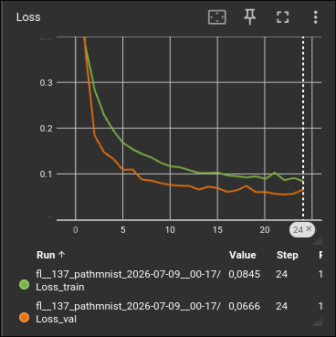
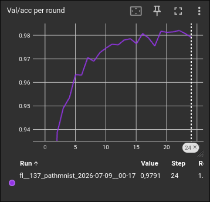
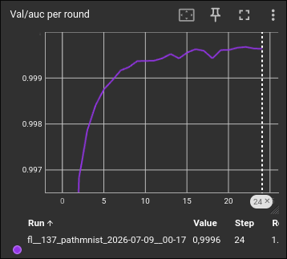

# Federated Learning Simulation

This project was created as part of my bachelor's thesis on Federated Learning (FL) in medicine. Its goal is an environment that simulates Federated Learning on a single machine. Multiple participants (e.g. clinics) train locally on their own data, and a server aggregates their models into a shared global model. The raw data never leaves the participants.

## Features

- **Dataset:** [MedMNIST](https://medmnist.com/) is integrated as the data source.
- **Central configuration:** `config.py` lets you control, among other things:
  - Number of participants
  - Optimizer
  - Data augmentation
  - Non-IID data distribution (`non_iid`)
  - Further training parameters
- **Aggregation:** The server uses **FedAvg** as its algorithm.
- **Monitoring:** TensorBoard is integrated to follow, for example, the validation loss curves.

## Installation

```bash
git clone https://github.com/levonbo/federated-learning-medical-imaging
cd federated-learning-medical-imaging
python -m venv venv
source venv/bin/activate
pip install -r requirements.txt
```

## Usage

1. Adjust the parameters in `config.py`.
2. Start the simulation:

   ```bash
   python main.py
   ```

## Monitoring Training with TensorBoard

```bash
tensorboard --logdir=tensorboard_runs
```

TensorBoard is then available at [http://localhost:6006](http://localhost:6006).

<!-- Insert screenshot here, e.g. validation loss curves -->
## Training Results



*Training loss (green) and validation loss (orange) over the training rounds.*

<table>
  <tr>
    <td></td>
    <td></td>
  </tr>
  <tr>
    <td align="center"><em>Validation accuracy</em></td>
    <td align="center"><em>Validation AUC</em></td>
  </tr>
</table>


## Background

Medical imaging data is sensitive and protected by the GDPR, and individual clinics often only have small sample sizes. Centralized training on pooled data is therefore usually not possible. Federated Learning avoids this by exchanging only model parameters.

## Author

Levon, bachelor's thesis in Media Informatics.
